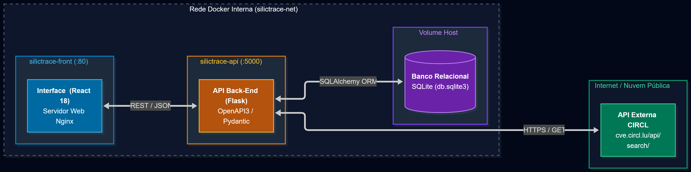

# 🛡️ SilicTrace | Front-end (React)

Bem-vindo ao repositório do **Front-end** do SilicTrace. Este projeto foi desenvolvido como Minimum Viable Product (MVP) para a Sprint de Desenvolvimento Back-end Avançado da PUC-Rio, implementado sob a topologia do **Cenário 1.1** (Interface SPA consumindo API REST própria, que se comunica com uma API externa pública e gerencia a persistência relacional).

---

## O Projeto

A proposta central do SilicTrace é fornecer uma interface de governança e inventário de hardware crítico (Workstations e Servidores de alta densidade), integrada a uma auditoria contínua de segurança na camada física de silício. Ao contrário de sistemas tradicionais de gestão patrimonial, o SilicTrace monitora e valida parâmetros profundos de firmware e microcódigo, correlacionando-os a bases públicas globais de vulnerabilidades conhecidas (CVEs).

A aplicação foi projetada para suportar a heterogeneidade da computação moderna com formulários adaptativos e contextuais de acordo com o ecossistema do processador:
* **Plataforma AMD:** Auditoria e validação de versões de encapsulamento **AGESA** (*AMD Generic Encapsulated Software Architecture*), como a vulnerabilidade *Zenbleed* / `CVE-2023-20593`.
* **Plataforma Intel:** Auditoria de revisões de microcódigo **MCU** (*Microcode Update*) e firmware **ME** (*Management Engine*), como a vulnerabilidade *Downfall* / `CVE-2022-40982`.

A interface foi concebida como uma Single Page Application (SPA) componentizada e de alta fidelidade visual, com feedback em tempo real para ações assíncronas e classificação visual por criticidade CVSS.

---

## Arquitetura da Aplicação (Cenário 1.1)

A solução organiza-se em camadas autônomas conteinerizadas com comunicação desacoplada via rede bridge:



1. **Front-End (`silictrace-front`):** SPA React 18 servida via Nginx Alpine na porta `80`.
2. **Back-End API (`silictrace-api`):** Serviço em Python/Flask na porta `5000` com documentação interativa Swagger/OpenAPI3.
3. **Persistência Local:** Base de dados SQLite montada via volume compartilhado no host.
4. **API Externa:** Consulta síncrona ao catálogo de segurança pública da CIRCL CVE Search.

---

## Tecnologias Utilizadas

* **React 18 & Vite:** Framework reativo e ferramenta de build de alta performance.
* **Lucide-React:** Biblioteca de ícones técnicos contextuais (placas-mãe, processadores, shields de risco).
* **Nginx (Alpine):** Servidor web ultraleve configurado para servir a aplicação estática em produção e gerenciar o fallback do roteamento SPA.
* **JavaScript (ES6+) & CSS3:** Gerenciamento de estado (`useState`, `useEffect`), manipulação dinâmica do DOM e estilização customizada em dark mode com feedback visual temático.
* **Docker & Docker Compose:** Conteinerização e orquestração dos serviços da aplicação.

---

## Funcionalidades

* **Painel de Ativos Monitorados:** Listagem de nós computacionais e servidores cadastrados com identificação de patrimônio e especificações técnicas.
* **Formulário Dinâmico e Contextual:** Ajuste imediato dos campos técnicos ao selecionar o fabricante (AMD exibe campo para AGESA; Intel habilita campos de MCU/ME).
* **Detecção e Alerta de Firmware:** Exibição detalhada de CVEs associadas ao processador, com tag identificadora, score CVSS e descrição do impacto.
* **Implementação dos 4 Métodos HTTP:**
  * `GET`: Leitura e carregamento reativo da base de dados no painel.
  * `POST`: Registro de novos equipamentos com auditoria de microcódigo imediata.
  * `PUT`: Ação rápida de *Atualizar Microcódigo* para simular a aplicação de patches e mitigação.
  * `DELETE`: Exclusão de ativos obsoletos e de suas auditorias.

---

## API Externa Utilizada

* **Serviço:** [CIRCL CVE Search API](https://cve.circl.lu/)
* **Mantenedor:** Computer Incident Response Center Luxembourg (CIRCL)
* **Autenticação:** Gratuita e pública (não exige cadastro prévio nem chaves de API).
* **Licença:** Open Security Data / Creative Commons.
* **Rota Consumida:** `GET https://cve.circl.lu/api/search/{vendor}`
* **Tratamento:** O consumo é processado pelo backend intermediário sem redirecionar a navegação do usuário, retornando as falhas estruturadas e integradas diretamente aos cards da interface.

---

## Estrutura do Projeto

* `/src`: Código-fonte da interface (`App.jsx`, `main.jsx`, `index.css`).
* `/public`: Arquivos públicos e ícones estáticos.
* `/docs`: Diretório contendo a imagem do diagrama de arquitetura (`arquitetura.png`).
* `Dockerfile`: Compilação da aplicação (Node 20 -> Nginx Alpine).
* `nginx.conf`: Arquivo de configuração de proxy estático e roteamento do Nginx.
* `docker-compose.yml`: Manifesto de orquestração do ecossistema completo.

---

## Como Executar Localmente

### Opção 1: Via Docker Compose

1. **Pré-requisito:** Certifique-se de que o **Docker** está em execução.
2. Clone ambos os repositórios na mesma pasta:
```bash
git clone https://github.com/viniciuscbastos/silictrace-front.git
git clone https://github.com/viniciuscbastos/silictrace-back.git
```
3. Acesse a pasta do front-end e inicie a orquestração:
```bash
cd silictrace-front
docker compose up -d --build
```
4. Abra o navegador e acesse:
* Interface (Front-End): http://localhost
* API Swagger (Back-End): http://localhost:5000/openapi

### Opção 2: Execução Direta no Ambiente Node.js

1. **Pré-requisito:** **Node.js 20+** e **npm** instalados.
2. Acesse a pasta do projeto e instale os pacotes:
```bash
cd silictrace-front
npm install
```
3. Inicie o servidor Vite em modo de desenvolvimento:
```bash
npm run dev
```
4. Acesse `http://localhost:5173` no navegador.